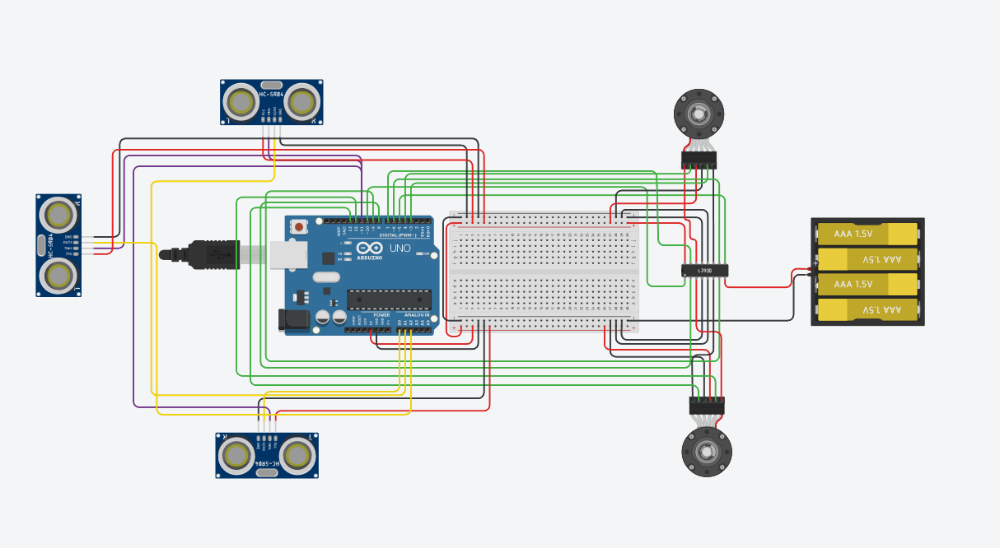
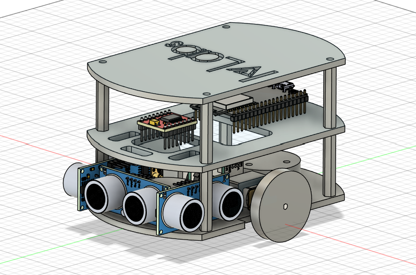
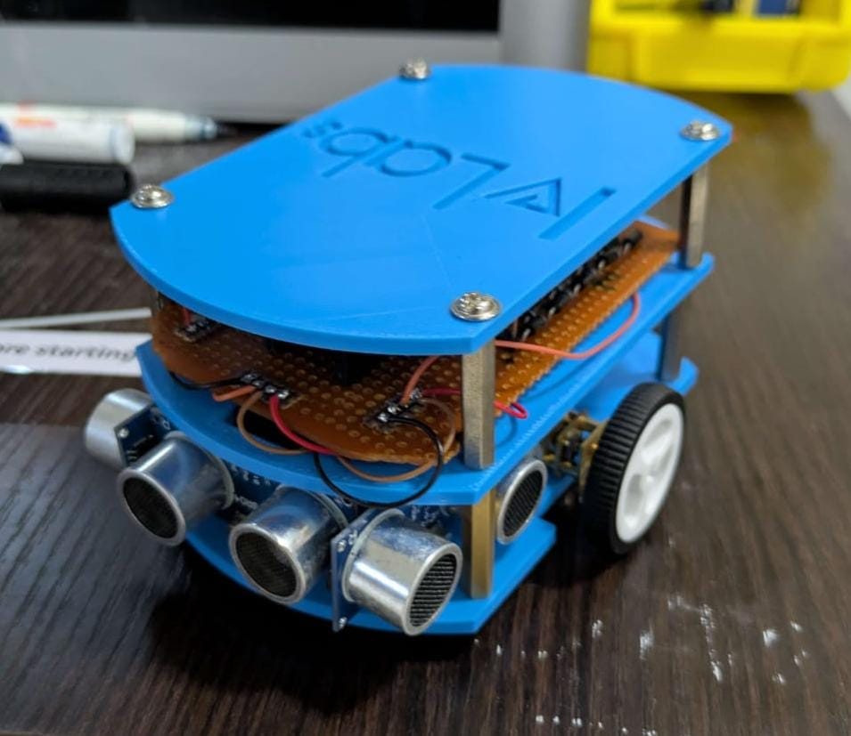
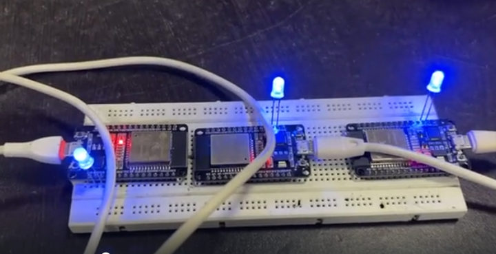
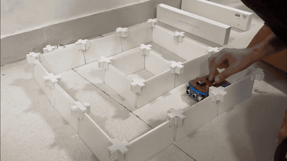

# Swarm of Micromouse

## Overview

This project involves designing, building, and programming three autonomous robotic mice (Micromouse) that can navigate an unknown maze, map it collaboratively, and find the optimal path from the starting point to a destination in the shortest time possible. The distinguishing feature of this project over a single-robot approach is that all three mice find the target position simultaneously, sharing real-time information so that no section of the maze is mapped twice by more than one robot.

---

## Objectives

- Build three autonomous robots capable of navigating an unknown maze without human intervention.
- Implement path planning algorithms for single-robot maze solving.
- Extend to a multi-agent swarm system where robots explore the maze independently but in a coordinated, non-redundant manner.
- Establish wireless peer-to-peer communication between robots using the ESP-NOW protocol.
- Avoid inter-robot collisions while maximizing exploration efficiency.

---

## Project Workflow

### 1. Path Planning Algorithms (Single Mouse)

Before moving to multi-agent behavior, path planning was studied and implemented for a single robot.

**Breadth-First Search (BFS)**
BFS was the first algorithm implemented. Using the PyMaze library, a randomly generated maze was solved by an agent navigating from one corner to the opposite corner. BFS guarantees the shortest path in an unweighted graph, making it a reliable baseline.

**Depth-First Search (DFS)**
DFS was tested with varying configurations, including different loop percentages and movement preferences (e.g., ENSW, WSNE ordering). While DFS successfully navigates mazes, it does not guarantee the shortest path, which was confirmed experimentally during testing.

**A* (A-Star)**
A* was implemented in Python to simulate maze solving. It uses a heuristic function (typically Manhattan distance) to guide the search, combining the cost-so-far and estimated cost-to-goal. This makes it significantly more efficient than BFS in large mazes. A* is the intended algorithm for the swarm robots in the final implementation.

---

### 2. Multi-Agent Simulation

After validating single-robot algorithms, the focus shifted to simulating multiple agents navigating a maze simultaneously.

The simulation uses BFS across all agents in parallel. Key constraints enforced in the simulation:
- No two agents map the same cell twice (shared map state).
- Agents do not collide with each other.
- There is no fixed goal cell; agents explore until the maze is fully mapped.

This phase validated the coordination logic before it was implemented on physical hardware.

---

### 3. Hardware Design

Each Micromouse was built from scratch using the following components:

| Component | Specification |
|---|---|
| Microcontroller | ESP32 |
| Distance Sensors | Ultrasonic sensors x3 (front, left, right) |
| Drive Motors | N20 DC Motors, 6V, with encoders x2 |
| Motor Driver | L293D |
| Power Source | LiPo battery, 6V |
| Voltage Regulation | Buck converter |

ESP32 Microcontroller:
The ESP32 acts as the central controller of the Micromouse, handling sensor processing, motor control, localization, and wireless communication. It was chosen for its dual-core processing capability, ample GPIO pins, built-in PWM and interrupt support, and native compatibility with the ESP-NOW protocol, enabling low-latency peer-to-peer communication between robots for real-time sharing of maze and wall data without requiring a Wi-Fi router.

Ultrasonic Sensors:
Three HC-SR04 ultrasonic sensors are mounted at the front, left, and right of the robot to detect surrounding walls by measuring echo return time. The sensor data is used to identify valid paths, update the maze map, and assist in maintaining proper wall alignment during navigation, providing the environmental information required for maze exploration.

N20 Motors with Encoders:
The robot uses two N20 DC geared motors with quadrature encoders in a differential-drive configuration. The encoders provide continuous feedback on wheel rotation, enabling accurate odometry for estimating distance traveled and robot orientation. This feedback is integrated with a PID controller to maintain straight-line motion, execute precise turns, and ensure accurate positioning within maze cells.

Motor Driver:
A dual H-bridge motor driver interfaces the ESP32 with the GM20 motors, supplying the required current while allowing independent control of each motor's speed and direction. The ESP32 generates PWM signals for speed regulation and digital control signals for forward, reverse, and turning maneuvers.

Custom PCB and Chassis:
A custom PCB was designed to integrate the ESP32, motor driver, sensor interfaces, encoder connections, and power distribution into a compact and reliable platform, reducing wiring complexity and improving robustness. The chassis was CAD-designed to optimize component placement, weight distribution, and sensor positioning while meeting the dimensional constraints of a Micromouse robot.

---

### 4. Circuit Design

The circuit was first designed and verified on TinkerCad before physical assembly.



**Power distribution:**
- A 6V LiPo battery powers the motors via pin 8 (Vcc2) of the L293D motor driver.
- The Arduino/ESP32 5V output powers the L293D logic supply via pin 16 (Vcc1) and also supplies the ultrasonic sensors via the breadboard 5V rail.
- All components share a common ground reference to prevent floating ground issues.

The L293D motor driver handles bidirectional motor control for both drive motors, with enable and direction pins connected to the ESP32's GPIO outputs.

---

### 5. CAD Model and 3D Printing

The mechanical chassis was designed as a CAD model scaled to the dimensions of the maze being used. Once the design was finalized, the chassis was 3D printed. The design accounts for sensor placement (front and sides), motor mounting, wheel alignment, and the PCB/breadboard positioning.

Single-bot testing was conducted on the physical hardware before swarm behavior was introduced.






---

### 6. Swarm Intelligence

Swarm intelligence allows multiple robots to operate as a collective system without centralized control. Each robot makes decisions based on its own local sensor data and information shared by the other robots. The system as a whole exhibits intelligent behavior through this decentralized coordination.

In this project, each Micromouse independently explores the maze while broadcasting its current position to the other two mice. When a robot receives position data from its peers, it avoids navigating to cells already being explored, effectively dividing the maze among the three robots without overlap.

**Properties of the swarm system:**
- Decentralized: no single robot is the master controller.
- Fault-tolerant: if one robot fails, the other two continue operating.
- Scalable: the communication model supports additional robots without architectural changes.

---

### 7. Communication Protocol: ESP-NOW

Two communication models were considered:

**Centralized (Master-Slave):** One robot acts as master, receives data from the others, makes decisions, and sends commands back. This introduces a single point of failure and does not scale well.

**Decentralized (Peer-to-Peer):** Each robot communicates directly with every other robot and makes its own decisions. This was the chosen approach.

**ESP-NOW** was selected as the communication protocol for the following reasons:

- **Low Latency:** Data is transmitted in near real-time, which is essential for coordinated movement.
- **No Infrastructure Required:** ESP-NOW works without a Wi-Fi router or access point, making it suitable for a closed arena environment.
- **Low Power Consumption:** Important for battery-operated robots where runtime matters.
- **Peer-to-Peer and Broadcast Support:** Supports both direct unicast messages between specific robots and broadcast to all robots simultaneously.
- **Acknowledgement (ACK):** ESP-NOW confirms data delivery, reducing the risk of a robot acting on stale or lost information.
- **Simple Integration:** ESP-NOW can be added directly on top of existing ESP32 motor and sensor code with minimal overhead.

Each robot is registered with the MAC addresses of the other two robots. When a robot moves to a new cell, it broadcasts its position. All robots maintain a shared map of explored cells, updated in real time as position data arrives.




---

### 8. Firmware — Navigation Logic ⚙️

Each robot runs the same firmware. The logic is cell-based: the robot always stops at the center of a maze cell, reads its sensors, decides a direction, turns if needed, and then drives exactly one cell forward. This repeats until the maze is fully explored.

#### Sensor Reading

Three ultrasonic sensors (left, front, right) are fired one at a time with a short delay between them to avoid cross-interference. Each sensor emits a 10µs trigger pulse and measures the echo duration. Distance in centimetres is derived from the travel time of sound. A 25ms timeout is applied so that an absent wall (open corridor) returns a safe large value rather than blocking execution.

```cpp
long readUltrasonic(int echoPin, int trigPin) {
  digitalWrite(trigPin, HIGH);
  delayMicroseconds(10);
  digitalWrite(trigPin, LOW);
  long duration = pulseIn(echoPin, HIGH, 25000);
  if (duration == 0) return 999;
  return duration * 0.034 / 2;
}
```

#### Decision Making — Depth-First Search (No Fixed Goal)

Each robot explores the maze using DFS with no predefined destination. The objective is full maze coverage — the robot keeps moving into unvisited cells until every reachable cell has been seen.

At each cell, the robot checks which neighbouring directions are open using sensor thresholds and then prioritises directions that have not yet been visited. This is the core of DFS: always go deeper into unexplored territory before backtracking. Visited cells are tracked in an internal stack and map. When all neighbours of the current cell are already visited, the robot backtracks along the stack until it finds a cell with at least one unvisited neighbour, then continues exploring from there.

The movement priority order when multiple open directions are available is: right → front → left. If all adjacent open cells are already visited, the robot backtracks (U-turn or retracing steps) rather than stopping.

```cpp
bool openRight = (sensor[2].dist > WALL_SIDE_OPEN_CM);
bool openFront = (sensor[1].dist > WALL_DETECT_CM);
bool openLeft  = (sensor[0].dist > WALL_SIDE_OPEN_CM);

// Prefer unvisited neighbours; fall back to backtrack if all visited
if      (openRight && !visited[rightNeighbour]) action = 'R';
else if (openFront && !visited[frontNeighbour]) action = 'F';
else if (openLeft  && !visited[leftNeighbour])  action = 'L';
else                                             action = 'B'; // backtrack
```

Because there is no goal cell, exploration continues until the DFS stack is empty, meaning every accessible cell has been visited. This makes DFS well suited for full maze mapping before any shortest-path optimisation is applied.

#### Turning — PID on Encoder Ticks

Turns are executed by driving the two wheels in opposite directions and counting encoder ticks. A PID controller watches how far the average of both encoders has progressed toward the target tick count and adjusts motor speed smoothly. A second correction term keeps both wheels spinning at the same rate so the turn stays tight and the robot ends up pointing in the right direction.

- 90° right turn target: `-505` ticks  
- 90° left turn target: `+505` ticks  
- 180° U-turn: two 90° right turns combined

The loop exits when the remaining error drops below 10 ticks, at which point both motors stop.

#### Moving One Cell — Wall-Following PID

`moveOneCellAlign()` drives the robot exactly one cell length (`TICKS_PER_CELL = 950` ticks on average) while actively keeping it centered in the corridor.

Two corrections are blended together every 20ms:

**Wall-centering error:** If both side walls are visible and valid, the robot tries to equalise the left and right distances. If only one wall is present, it holds a fixed 5 cm clearance from that wall. If neither wall is in range it falls back to encoder sync only.

**Encoder sync error:** The difference in tick increments between the right and left encoder since the last sample. This catches any speed mismatch between the two motors and trims the PWM values to keep the robot driving straight even in the absence of wall data.

```cpp
float wallCorr = FW_KP * err + FW_KD * derr;   // proportional + derivative on wall error
float syncCorr = SYNC_KP * syncErr;             // proportional on encoder delta

int pwmRight = BasePWM - wallCorr - syncCorr;
int pwmLeft  = BasePWM + wallCorr + syncCorr;
```

If the front sensor detects a wall closer than `WALL_DETECT_CM` (4 cm) before the tick target is reached, the robot stops early to avoid a collision. Once the tick target is met, both motors stop hard.

#### Calibration Constants

These values must be tuned for each physical robot before deployment:

| Constant | Default | Meaning |
|---|---|---|
| `TICKS_PER_CELL` | 950 | Encoder ticks for one maze cell |
| `TICKS_FOR_90_DEG_TURN_LEFT` | 505 | Ticks for a 90° left turn |
| `BasePWM` | 215 | Base drive speed (0–255) |
| `WALL_DETECT_CM` | 4 | Front wall blocking threshold |
| `SIDE_TARGET_CM` | 5 | Desired side clearance while moving |



---

## Repository Structure

```
codes_and_resources/
├── simulation/
│   ├── bfs_single.py          # BFS on a single agent using PyMaze
│   ├── dfs_single.py          # DFS with configurable movement preferences
│   ├── astar_single.py        # A* algorithm simulation
│   └── multiagent_bfs.py      # Simultaneous multi-agent BFS exploration
├── hardware/
│   ├── circuit/               # TinkerCad circuit design files
│   └── cad/                   # CAD model files for 3D printing
├── firmware/
│   ├── main/                  # Main ESP32 firmware
│   ├── espnow/                # ESP-NOW communication implementation
│   └── motor_control/         # Motor driver and encoder logic
└── README.md
```

---

## Getting Started

### Simulation

1. Install dependencies:
   ```bash
   pip install pyamaze
   ```

2. Run a single-agent simulation:
   ```bash
   python simulation/bfs_single.py
   ```

3. Run the multi-agent simulation:
   ```bash
   python simulation/multiagent_bfs.py
   ```

### Firmware

1. Install the [Arduino IDE](https://www.arduino.cc/en/software) or [PlatformIO](https://platformio.org/).
2. Install the ESP32 board support package.
3. Open the firmware from the `firmware/main/` directory.
4. Flash to each ESP32, ensuring each robot is assigned its unique device ID and the MAC addresses of the other two robots are correctly configured in the ESP-NOW setup.
